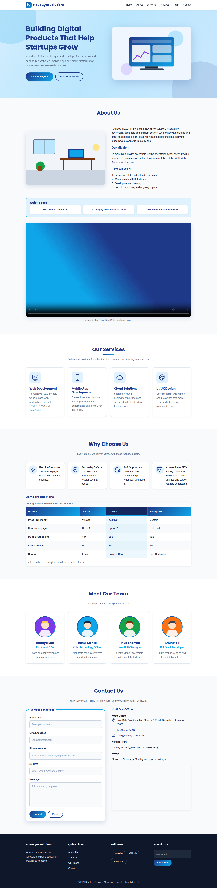
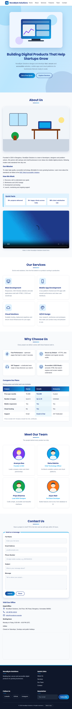
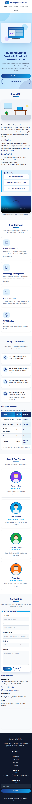

# NovaByte Solutions – Responsive CSS3 Website

**ApexLark Full Stack Development Internship – Day 02 Task**
**Topic:** CSS3 Styling, Flexbox & Responsive Web Design
**Intern:** Vanshika Dhiman &nbsp;|&nbsp; **Date:** 03 November 2026

---

## Objective

Style the Day 01 semantic HTML website using an external CSS stylesheet, build the layouts with
Flexbox, and make the page responsive across desktop, tablet and mobile devices.

## What Was Done

### 1. Project Setup
The Day 01 project was reorganised into the required Day 02 structure. The internal `<style>` block
was removed from `index.html` and replaced with links to Google Fonts and `css/style.css`.

### 2. CSS Styling
- **Typography:** Google Fonts – *Poppins* (headings) and *Inter* (body text)
- **Colour palette:** CSS custom properties (`--primary`, `--accent`, `--light`, `--dark` …)
- **Backgrounds & gradients:** brand gradient on buttons, table header and hero background
- **Borders & border-radius:** rounded cards, inputs, buttons, images and map
- **Spacing & depth:** consistent margin/padding, layered `box-shadow`s
- **Transitions:** smooth `0.3s` transitions on buttons, cards, links and form fields

### 3. Flexbox Layouts
| Section | Flexbox properties used |
|---------|-------------------------|
| Navigation bar | `display: flex`, `justify-content: space-between`, `align-items`, `flex-wrap`, `gap` |
| Hero | `display: flex`, `align-items: center`, `flex-wrap`, `gap` |
| Services | `display: flex`, `flex-wrap`, `justify-content`, `gap`, `flex: 1 1 230px` |
| Features | `display: flex`, `flex-wrap`, `gap`, `align-items` |
| Team | `display: flex`, `flex-wrap`, `justify-content`, `gap` |
| Contact | `display: flex`, `flex-direction: column` (form), `flex-wrap` (layout) |
| Footer | `display: flex`, `justify-content: space-between`, `flex-wrap`, `gap` |

### 4. Responsive Design (Media Queries)
| Device | Breakpoint | Behaviour |
|--------|-----------|-----------|
| Desktop | > 992px | 4 cards per row, side-by-side hero and about sections |
| Tablet | 577px – 992px | 2 cards per row, hero stacked, footer in 2 columns |
| Mobile | ≤ 576px | Single column, stacked header and nav, full-width buttons |

### 5. UI Enhancements
- **Hover card effects:** cards lift, gain an accent border and a stronger shadow
- **Animated nav links:** gradient underline grows from left to right on hover/focus
- **Smooth scrolling:** `scroll-behavior: smooth` with `scroll-padding-top` for the sticky header
- **Styled contact form:** rounded inputs, focus glow, green/red validation borders
- **Accessibility:** visible focus outlines and `prefers-reduced-motion` support

### 6. Extra Styling (Section 13 of `style.css`)
- Slowly animated gradient hero with floating shapes and a floating hero image
- Button "shine" sweep on hover
- Gradient accent bar on cards, icon badges for services and features, gradient ring on team photos
- Quick Facts shown as a Flexbox stat strip
- Highlighted "Growth" column in the pricing table
- Footer social links as pill chips, custom text-selection and scrollbar colours

## Folder Structure

```
Day-02-CSS/
│
├── index.html
├── css/
│   └── style.css
├── assets/
│   ├── images/
│   ├── icons/
│   └── media/            (intro video used by index.html)
├── screenshots/
│   ├── desktop-view.png
│   ├── tablet-view.png
│   └── mobile-view.png
└── README.md
```

## How to Run

1. Clone the repository:
   ```bash
   git clone https://github.com/<your-username>/Day-02-CSS.git
   ```
2. Open the `Day-02-CSS` folder in **Visual Studio Code**.
3. Open `index.html` in **Google Chrome** (or use the Live Server extension).
4. An internet connection is needed for Google Fonts and the embedded map.

## CSS Validation

Validate `css/style.css` with the **W3C CSS Validator** (https://jigsaw.w3.org/css-validator/#validate_by_upload)
by uploading the file, then paste the result here.

> Result: _(add your validator result / screenshot here after running it)_

## Screenshots

### Desktop


### Tablet


### Mobile


## Tools Used
- HTML5, CSS3 (Flexbox, media queries, custom properties)
- Visual Studio Code, Google Chrome
- Google Fonts, W3C CSS Validator
- Git & GitHub

## Learning Outcomes
- Applied CSS3 styling: colours, gradients, shadows, transitions
- Built Flexbox layouts for navigation, hero, cards and footer
- Used media queries for mobile, tablet and desktop breakpoints
- Organised CSS in a clean, commented, professional structure

---
© 2026 NovaByte Solutions (fictional company created for the ApexLark internship task).
